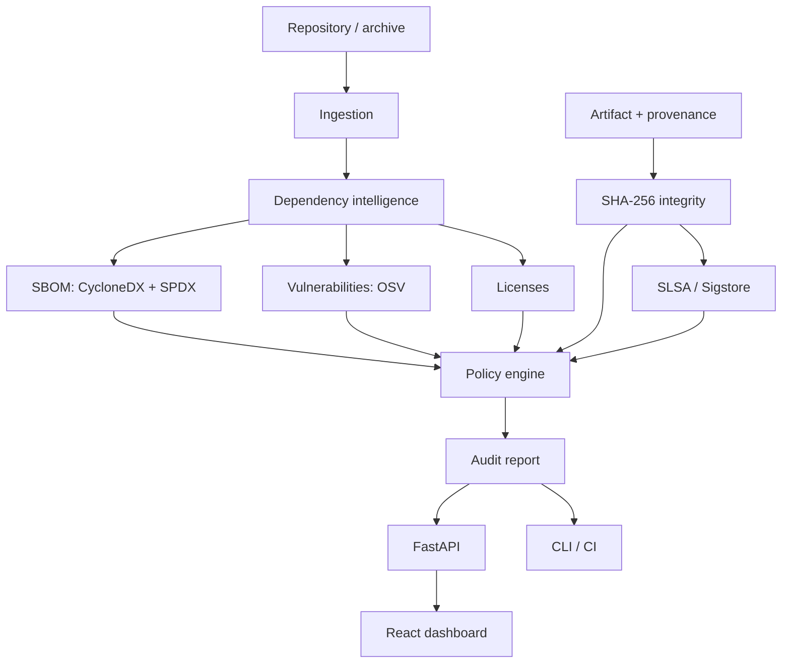

# AegisChain

### Software Supply Chain Security & Provenance Platform

AegisChain analyses a software repository (and, optionally, a build artifact with provenance
evidence) and produces a **deterministic security decision** - `PASS`, `FAIL`, `WARN` or
`INDETERMINATE` - backed by SBOMs, vulnerability and license findings, integrity checks and
provenance verification.

Its central rule: **absence of evidence is never a pass.** A vulnerability lookup that failed, a
missing signature or an unparseable lockfile yields `INDETERMINATE`, not `PASS`. "No vulnerability
found" is not "proven free of vulnerabilities".

## Key features

- **Dependency intelligence:** Python and Node.js manifests and lockfiles, dependency graph,
  direct/transitive classification, depth, cycles, duplicate/conflicting versions, manifest vs
  lockfile consistency.
- **SBOMs:** CycloneDX 1.5 and SPDX 2.3 from one internal model, cross-checked for consistency.
- **Vulnerabilities:** OSV batch queries with retry, pagination and caching, local range
  verification, CVSS v3 scoring, fix availability.
- **Licenses:** SPDX expression parsing (AND / OR / WITH), allow/deny policies, no guessing.
- **Integrity and provenance:** streaming SHA-256, SLSA provenance checks, Sigstore signature
  verification (delegated to the official client), trusted builder/source/identity policy.
- **Policy engine:** strict YAML, expiring waivers, pure deterministic evaluation, re-evaluation of
  stored evidence under another policy.
- **Delivery:** CLI, FastAPI backend, PostgreSQL persistence (immutable runs, append-only audit
  log), React + TypeScript dashboard, Docker Compose, GitHub Actions.

## Architecture



A modular monolith: engines depend only on the domain layer and receive collaborators by injection,
so the same core runs from the CLI, the API or CI. See [`docs/architecture`](docs/architecture/system-architecture.md).

## Technology stack

| Area | Used |
|---|---|
| Core | Python 3.12, stdlib frozen dataclasses, NetworkX, `packaging`, PyYAML |
| API | FastAPI, Pydantic (boundary validation), SQLAlchemy 2, Alembic, PostgreSQL |
| Frontend | React, TypeScript, Tailwind CSS, React Flow, Recharts |
| Standards | CycloneDX 1.5, SPDX 2.3, Package URL, OSV, SLSA provenance, in-toto, Sigstore |
| Quality | pytest, Hypothesis, Ruff, mypy (strict) |
| Delivery | Docker Compose, GitHub Actions (artifact attestation via Sigstore keyless) |

## Supported ecosystems

| Ecosystem | Files | Status |
|---|---|---|
| Python | `requirements*.txt`, `pyproject.toml` (PEP 621/735, Poetry), `poetry.lock`, `uv.lock` | supported |
| Node.js | `package.json`, `package-lock.json` (v2/v3), `npm-shrinkwrap.json` | supported |
| Node.js | `pnpm-lock.yaml`, `yarn.lock` | detected, **not analysed** (reported as unsupported) |
| Go, Rust, Java, Pipfile | | not supported |

## Installation

```bash
python -m venv .venv && source .venv/bin/activate     # PowerShell: .\.venv\Scripts\Activate.ps1
python -m pip install -e ".[api,security,dev]" -e apps/api
make fix && make check          # first run: format + lint + type check + tests
```

## Quick start

```bash
# CLI (exit code: 0 PASS/WARN, 1 FAIL, 2 INDETERMINATE, 3 usage error)
aegischain analyze examples/python-project --policy configs/policies/default.yaml --out artifacts

# Offline (no OSV lookup): the decision is INDETERMINATE by design
aegischain analyze examples/node-project --offline

# Hash + compare an artifact against a reference digest obtained out-of-band
aegischain verify-artifact dist/app.tar.gz --expected-sha256 <hex>

# Full stack
cp .env.example .env && docker compose up --build        # dashboard: http://localhost:8080
```

## Example analysis

Real output of `aegischain analyze examples/python-project --offline` (committed in
[`reports/sbom-validation/python-project`](reports/sbom-validation/python-project/reports/report.md)):

```
Final decision: INDETERMINATE

| Engine                  | Status        | Evaluated          |
| Dependency Analysis     | PASS          | yes                |
| SBOM Validation         | PASS          | yes                |
| Vulnerability Analysis  | INDETERMINATE | yes                |
| License Compliance      | WARN          | yes                |
| Artifact Integrity      | PASS          | no (not required)  |
| Provenance Verification | PASS          | no (not required)  |

- [Vulnerability Analysis] Vulnerability lookup skipped: ... This is NOT evidence that the
  dependencies are vulnerability-free.
- [License Compliance] 13 component(s) have a missing, invalid or custom license
```

The licenses are `UNKNOWN` because Poetry lockfiles carry no license metadata and AegisChain does not
guess; supply evidence with `--license-evidence` or use an npm lockfile (which does carry it).

## SBOM examples

[`sbom.cdx.json`](reports/sbom-validation/python-project/sbom/sbom.cdx.json) (CycloneDX 1.5),
[`sbom.spdx.json`](reports/sbom-validation/python-project/sbom/sbom.spdx.json) (SPDX 2.3) and
[`validation-report.json`](reports/sbom-validation/python-project/sbom/validation-report.json).
Nothing is invented: no supplier, no license or hash without a source, no version when unpinned.

## API documentation

[`docs/api/api-reference.md`](docs/api/api-reference.md); interactive docs at `/docs` when running.
All routes need `X-API-Key`; clients never provide filesystem paths.

## Dashboard preview

Seven pages (Overview, Projects, Dependencies with interactive graph, SBOM Explorer,
Vulnerabilities, Provenance, Policy & Reports); every number comes from the API.
**Screenshots have not been captured yet** (the dashboard could not be run in the environment where
this was developed); capture them from your own running instance - see `docs/images/README.md`.

## Testing and quality assurance

- 203 automated tests passing in development (unit, property-based, security, integration, end to
  end, API service layer); 3 more are skipped when optional dependencies (Hypothesis, FastAPI/httpx,
  PostgreSQL) are absent and run in CI.
- Per-engine evaluation against ground truth: `python benchmarks/run_evaluation.py`
  ([results](reports/final/evaluation-summary.md)).
- Defects found by the tests while building: lenient package.json validation, an empty policy file
  silently defaulting, valid zips rejected as links - all fixed with regression tests.

**Verification status.** Executed and passing: core engines, CLI, policy, SBOM, integrity,
archive handling, API service layer. **Written but not executed** where it was developed (no
network access): FastAPI HTTP layer, SQLAlchemy/PostgreSQL repository and Alembic migration, React
dashboard, Dockerfiles, GitHub workflows, `ruff`/`mypy`, Sigstore CLI integration. The first CI run
is their first real verification; see [`docs/security/limitations.md`](docs/security/limitations.md).

## Benchmark results

Offline pipeline, synthetic seeded dependency graphs, 5 runs each, fresh process per run
([details](docs/evaluation/benchmark-results.md)):

| Dataset | Components | Median runtime | Peak RSS |
|---|---|---|---|
| npm-small | 50 | 0.007 s | 37.4 MiB |
| npm-medium | 1,000 | 0.078 s | 42.4 MiB |
| npm-large | 10,000 | 0.821 s | 87.2 MiB |
| poetry-small | 50 | 0.007 s | 37.3 MiB |
| poetry-medium | 1,000 | 0.084 s | 41.3 MiB |
| poetry-large | 5,000 | 0.414 s | 56.4 MiB |

Near-linear scaling; network time excluded; synthetic data only.

## Threat model and security

[`docs/security/threat-model.md`](docs/security/threat-model.md) (STRIDE, 15 threats),
[trust model](docs/security/trust-model.md), [limitations](docs/security/limitations.md),
[`SECURITY.md`](SECURITY.md). Repository code is never executed; links are never followed;
credential-like files are never opened.

## Engineering design decisions

[ADR-0001 .. ADR-0007](docs/design-decisions/) cover the modular monolith, ecosystem scope, SBOM
formats, OSV, provenance verification, policy semantics and the stdlib-core choice.

## Limitations

Only the listed ecosystems; unpinned requirements cannot be scanned; licenses only from stated
metadata; no reachability analysis; CVSS v4 not scored; structural (not schema) SBOM validation in
the product; single shared API key; synchronous analysis. Full list in
[`docs/security/limitations.md`](docs/security/limitations.md).

## Roadmap

Official CycloneDX library + schema validation, SPDX 3.0, pnpm/yarn/Go/Cargo, per-user auth and rate
limiting, asynchronous analysis queue, real-repository evaluation, verified end-to-end Sigstore tests.

## Project status

Early development (0.1.0). Reports: [`reports/final`](reports/final/).

## Contributing

See [`CONTRIBUTING.md`](CONTRIBUTING.md).

## License

MIT - see [`LICENSE`](LICENSE).
