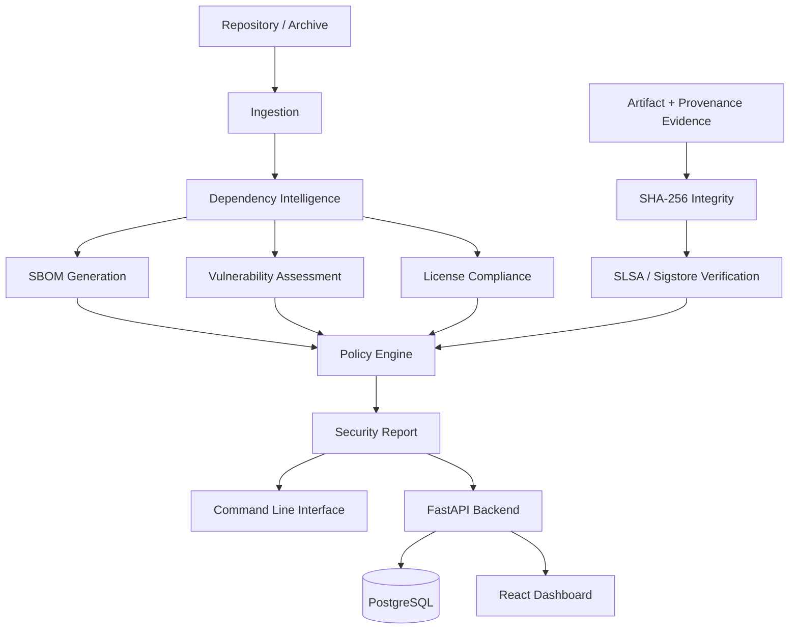
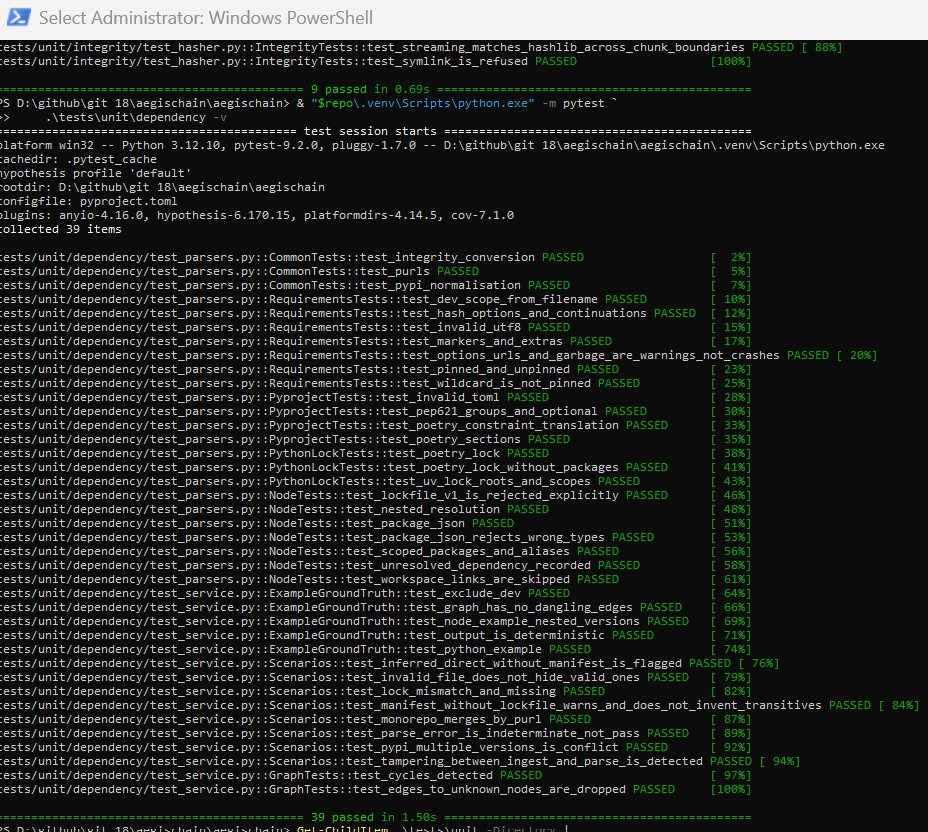
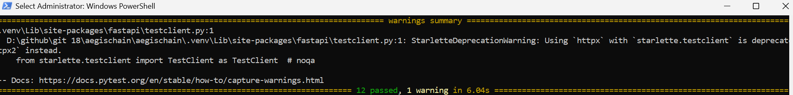
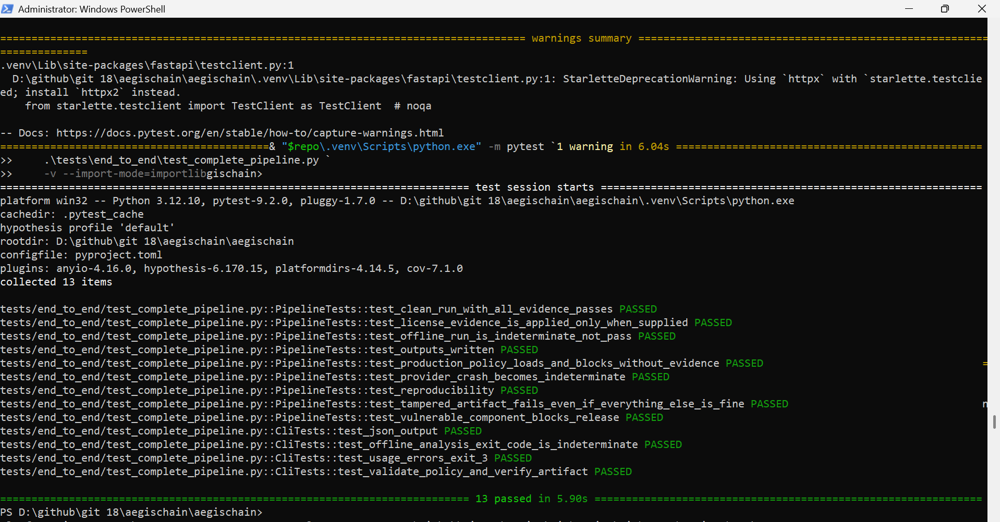
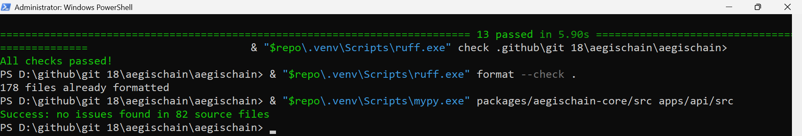
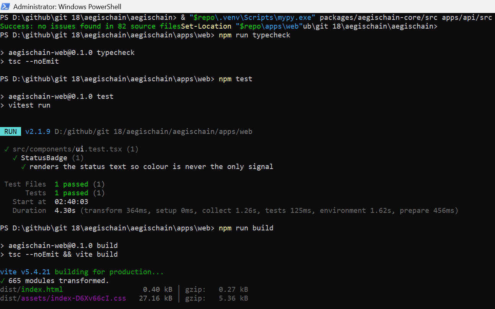
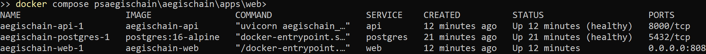
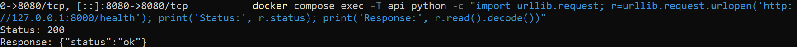
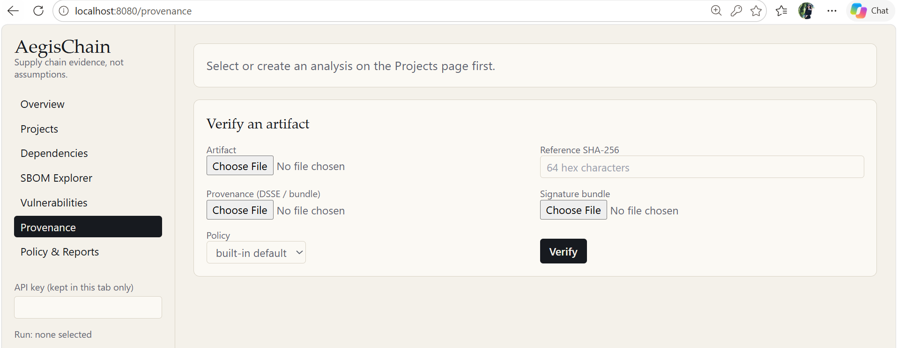
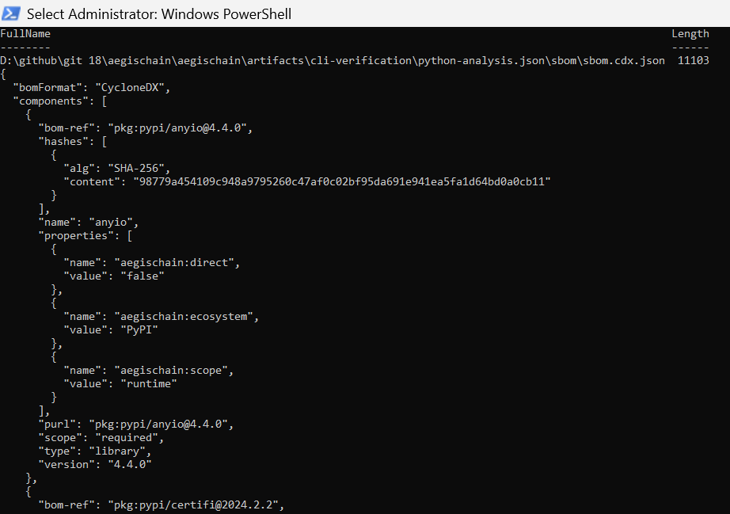

# AegisChain

### Software Supply Chain Security & Provenance Platform

**AegisChain** is a software supply-chain security platform designed to analyse software repositories, evaluate dependency and artifact evidence, and produce deterministic, explainable security decisions.

It integrates dependency intelligence, Software Bill of Materials (SBOM) generation, vulnerability assessment, license compliance, artifact integrity verification, provenance evaluation, and policy enforcement into a modular platform.

Its central security principle is:

> **Absence of evidence is never a pass.**

A failed vulnerability lookup, missing signature, unsupported dependency format, or insufficient provenance evidence must never be interpreted as proof of security. When evidence is incomplete, AegisChain reports `INDETERMINATE` rather than incorrectly claiming `PASS`.

---

## Project Overview

AegisChain brings multiple software supply-chain security capabilities into one analysis pipeline.

| Capability | Description |
|---|---|
| Dependency intelligence | Parse manifests, lockfiles, and dependency relationships |
| SBOM generation | Generate CycloneDX 1.5 and SPDX 2.3 documents |
| Vulnerability assessment | Integrate OSV data and evaluate affected-version ranges |
| License compliance | Evaluate SPDX expressions against configurable policies |
| Artifact integrity | Verify artifacts using streaming SHA-256 hashing |
| Provenance verification | Evaluate SLSA and Sigstore-related evidence |
| Policy engine | Produce deterministic security decisions |
| Audit reporting | Preserve findings and evidence for analysis and review |
| CLI | Execute repository and artifact analysis |
| Backend API | Expose analysis functionality through FastAPI |
| Frontend | Present security information through a React dashboard |
| Deployment | Run services using Docker Compose and PostgreSQL |

### Security Decision Model

AegisChain uses four decision states:

| Decision | Interpretation |
|---|---|
| `PASS` | Required checks passed with sufficient evidence |
| `FAIL` | A policy violation or failed security check was identified |
| `WARN` | Findings require attention but do not necessarily fail the policy |
| `INDETERMINATE` | Evidence is insufficient to make a reliable decision |

This model distinguishes between a genuinely successful security evaluation and an evaluation that could not establish a reliable conclusion.

---

## Architecture

AegisChain follows a modular-monolith architecture. Security engines depend on the domain layer and receive collaborators through dependency injection.

This allows the same core analysis functionality to be reused by the command-line interface, backend API, and CI-oriented workflows.



*Figure 1. AegisChain architecture, illustrating the relationship between repository ingestion, security engines, policy evaluation, reporting, and delivery interfaces.*

### Architectural principles

- **Separation of concerns:** security engines remain independent of presentation and delivery layers.
- **Dependency injection:** external collaborators are supplied to application components rather than hard-coded into the domain.
- **Deterministic evaluation:** equivalent evidence and policies should produce consistent decisions.
- **Evidence-driven security:** missing or unavailable evidence is explicitly represented.
- **Reusable core:** CLI and API workflows share the same analysis functionality.

---

## Core Features

### 1. Dependency Intelligence

AegisChain analyses supported Python and Node.js project metadata.

Capabilities include:

- Python and Node.js manifest parsing.
- Supported lockfile parsing.
- Dependency graph construction.
- Direct and transitive dependency classification.
- Dependency depth tracking.
- Cycle detection.
- Duplicate and conflicting package-version identification.
- Manifest and lockfile consistency checks.
- Development dependency filtering where supported.

### 2. Software Bill of Materials

AegisChain generates two SBOM formats from a shared internal component model.

| Format | Version |
|---|---|
| CycloneDX | 1.5 |
| SPDX | 2.3 |

The outputs are cross-checked for component and dependency consistency.

The implementation avoids inventing package suppliers, licenses, versions, or hashes when the source evidence does not provide them.

### 3. Vulnerability Assessment

The vulnerability engine integrates with the Open Source Vulnerabilities (OSV) ecosystem.

Implemented capabilities include:

- OSV batch-query integration.
- Retry handling.
- Pagination support.
- Vulnerability-result caching.
- Local affected-version range verification.
- CVSS v3 scoring.
- Fix-availability information.
- Explicit handling of unavailable vulnerability evidence.

When online vulnerability information cannot be retrieved, the platform does not interpret the absence of results as proof that dependencies are safe.

### 4. License Compliance

The license engine supports:

- SPDX license-expression parsing.
- `AND`, `OR`, and `WITH` expressions.
- Configurable allow and deny policies.
- Unknown-license handling.
- Optional external license evidence.
- Explicit compliance findings.

License decisions are based on available evidence rather than assumptions.

### 5. Artifact Integrity

The integrity engine provides:

- Streaming SHA-256 hashing.
- Expected-digest comparison.
- File validation.
- Handling of missing and invalid artifacts.
- Detection of file modification during hashing.
- Protection against symbolic-link inputs.

### 6. Provenance Verification

The provenance subsystem evaluates software build evidence.

Its design includes:

- SLSA provenance statements.
- in-toto statement handling.
- Builder and source identity evaluation.
- Trusted-identity policy checks.
- Sigstore verification integration through the official client.

External Sigstore verification workflows require environment-dependent validation and are not claimed as fully end-to-end verified.

### 7. Policy Engine

The policy engine provides:

- Strict YAML policy parsing.
- Deterministic evaluation.
- Expiring waivers.
- Allow and deny rules.
- Security decision aggregation.
- Re-evaluation of stored evidence under another policy.
- Explainable findings.

### 8. Audit and Reporting

The platform generates structured security reports containing:

- Final security decisions.
- Individual engine statuses.
- Dependency findings.
- Vulnerability information.
- License findings.
- Integrity and provenance evidence.
- Policy evaluation results.

The backend is designed around immutable analysis runs and append-only audit records.

---

## Technology Stack

| Layer | Technologies |
|---|---|
| Core language | Python 3.12 |
| Core architecture | Frozen dataclasses, dependency injection |
| Dependency analysis | NetworkX, `packaging` |
| Configuration | PyYAML |
| Backend | FastAPI, Pydantic |
| Persistence | SQLAlchemy 2, Alembic |
| Database | PostgreSQL 16 |
| Frontend | React 18, TypeScript |
| Styling | Tailwind CSS |
| Visualisation | React Flow, Recharts |
| SBOM standards | CycloneDX 1.5, SPDX 2.3 |
| Vulnerability intelligence | OSV |
| Provenance standards | SLSA, in-toto, Sigstore |
| Testing | pytest, Hypothesis |
| Code quality | Ruff, mypy |
| Deployment | Docker, Docker Compose |

---

## Supported Ecosystems

| Ecosystem | Input format | Status |
|---|---|---|
| Python | `requirements*.txt` | Supported |
| Python | `pyproject.toml` | Supported |
| Python | `poetry.lock` | Supported |
| Python | `uv.lock` | Supported |
| Node.js | `package.json` | Supported |
| Node.js | `package-lock.json` v2/v3 | Supported |
| Node.js | `npm-shrinkwrap.json` | Supported |
| Node.js | `pnpm-lock.yaml` | Detected, not analysed |
| Node.js | `yarn.lock` | Detected, not analysed |
| Go, Rust, Java, Pipfile | — | Not supported |

Unsupported dependency formats are reported as unsupported rather than silently treated as successfully analysed.

---

## Repository Structure

```text
aegischain/
│
├── apps/
│   ├── api/                       # FastAPI backend
│   └── web/                       # React + TypeScript dashboard
│
├── packages/
│   └── aegischain-core/            # Core security platform
│
├── configs/
│   └── policies/                  # Security policy configurations
│
├── database/                      # Database and Alembic configuration
│
├── docker/
│   ├── api.Dockerfile
│   └── web.Dockerfile
│
├── examples/
│   ├── python-project/
│   └── node-project/
│
├── tests/
│   ├── unit/
│   ├── integration/
│   ├── property/
│   ├── fixtures/
│   └── end_to_end/
│
├── benchmarks/
│
├── docs/
│   ├── architecture/
│   ├── api/
│   ├── design-decisions/
│   └── security/
│
├── reports/
│
├── artifacts/
│   ├── cli-verification/
│   └── screenshots/
│
├── docker-compose.yml
├── pyproject.toml
├── .env.example
├── SECURITY.md
├── CONTRIBUTING.md
└── README.md
```

---

## Installation and Setup

### Prerequisites

- Python 3.12
- Node.js 22 or later
- npm
- Docker Desktop
- Docker Compose

### 1. Clone the repository

```bash
git clone <repository-url>
cd aegischain
```

### 2. Create a Python virtual environment

Windows PowerShell:

```powershell
python -m venv .venv
.\.venv\Scripts\Activate.ps1

python -m pip install -e ".[api,security,dev]" -e apps/api
```

### 3. Install frontend dependencies

```powershell
cd apps/web
npm install
cd ../..
```

### 4. Configure environment variables

```powershell
Copy-Item .env.example .env
```

Configure strong local values for:

- `POSTGRES_PASSWORD`
- `AEGISCHAIN_API_KEY`
- `AEGISCHAIN_OFFLINE`

Do not commit `.env` or expose credentials in screenshots.

### 5. Start the full application

From the repository root:

```powershell
docker compose up --build -d
```

The frontend is exposed at:

`http://localhost:8080`

The API runs inside the Docker Compose network.

---

## CLI Usage

### Analyse a Python project

```powershell
aegischain analyze examples/python-project `
    --policy configs/policies/default.yaml `
    --out artifacts
```

### Analyse a Node.js project offline

```powershell
aegischain analyze examples/node-project --offline
```

Offline vulnerability lookup is not evidence that dependencies are vulnerability-free. The resulting decision must preserve this uncertainty.

### Verify an artifact

```powershell
aegischain verify-artifact dist/app.tar.gz `
    --expected-sha256 <expected-digest>
```

The expected digest should be obtained independently from a trusted source.

### Validate a security policy

```powershell
aegischain validate-policy configs/policies/default.yaml
```

### CLI exit codes

| Exit code | Meaning |
|---:|---|
| `0` | PASS or WARN |
| `1` | FAIL |
| `2` | INDETERMINATE |
| `3` | Usage or operational error |

---

## Verification and Testing

AegisChain has undergone local execution and verification on Windows, including security engine tests, backend service tests, frontend checks, database migration, Docker deployment, and end-to-end pipeline tests.

### Overall automated testing

<details>
<summary><strong>Full test suite – 211 passed, 1 skipped</strong></summary>


*Full automated test-suite execution. One test was skipped because the PostgreSQL integration-test environment variable was not configured for that run.*

</details>

### Security engine test results

| Engine | Passed |
|---|---:|
| Integrity | 9 |
| Dependency | 39 |
| Vulnerability | 31 |
| License | 11 |
| SBOM | 8 |
| Provenance | 16 |
| Policy | 23 |
| Ingestion | 14 |
| **Total** | **151** |



*Independent test execution across the eight core security engines.*

### Backend API tests



*Backend API service-layer tests covering the application's API services. The recorded result was 12 passed tests.*

### End-to-end pipeline



*End-to-end pipeline verification. The latest targeted execution completed with 13 passed tests in 2.07 seconds.*

### Static analysis and code quality

The project was checked using Ruff and mypy.

| Check | Recorded result |
|---|---|
| Ruff lint | Passed |
| Ruff format check | Passed |
| mypy strict type checking | Passed |
| mypy source files | 82 files |



*Static analysis and type-checking results from the local development environment.*

---

## Frontend Verification

The React and TypeScript frontend was installed, type-checked, tested, and built locally.

| Check | Result |
|---|---|
| TypeScript typecheck | Passed |
| Frontend unit tests | 1 passed |
| Production build | Passed |



*Frontend verification showing TypeScript checks, unit testing, and Vite production build output.*

---

## Docker and Database Verification

The full application stack was built and started using Docker Compose.

| Component | Observed status |
|---|---|
| PostgreSQL 16 | Healthy |
| Alembic migration | Revision `0001` confirmed |
| API container | Healthy |
| Web container | Running |
| Docker image builds | Successful |



*Docker Compose service status showing the locally deployed database, API, and frontend containers.*

### API health check

The API health endpoint was tested from inside the API container.

Observed response:

```json
{
  "status": "ok"
}
```

HTTP status: `200 OK`.



*Successful HTTP health response from the running API container.*

### Frontend availability

The frontend server responded successfully at:

`http://localhost:8080`



*Local frontend interface served through the Dockerised web application. A successful HTTP response confirms server availability, not that every dashboard interaction has been tested.*

---

## SBOM Generation Examples

AegisChain generated CycloneDX and SPDX SBOM outputs for both Python and Node.js example projects.

### CycloneDX 1.5



*CycloneDX 1.5 output generated from the Python example project, including component and dependency information.*

### SPDX 2.3


*Corresponding SPDX 2.3 output generated from the same analysis model.*

### Generated output locations

```text
artifacts/
└── cli-verification/
    ├── python-analysis.json/
    │   └── sbom/
    │       ├── sbom.cdx.json
    │       └── sbom.spdx.json
    │
    ├── node-analysis.json/
    │   └── sbom/
    │       ├── sbom.cdx.json
    │       └── sbom.spdx.json
    │
    ├── python-no-dev/
    │   └── sbom/
    │
    └── node-no-dev/
        └── sbom/
```

The generated documents were structurally checked, and component/dependency sets were cross-checked across the two formats.

**Validation scope:** the current product validation is structural. It is not a claim of complete external JSON Schema validation.

---

## Recorded Local Verification Summary

| Area | Result |
|---|---|
| Full automated test suite | 211 passed, 1 skipped |
| Security engine tests | 151 passed |
| Backend API service tests | 12 passed |
| End-to-end tests | 13 passed |
| Frontend unit tests | 1 passed |
| TypeScript typecheck | Passed |
| Frontend production build | Passed |
| Ruff lint and formatting | Passed |
| mypy strict | Passed, 82 source files |
| PostgreSQL service | Healthy |
| Alembic migration | `0001` confirmed |
| API health endpoint | HTTP 200 |
| Frontend HTTP response | HTTP 200 |
| Docker image builds | Successful |

**Test-count note:** the engine, backend, and end-to-end test results are separate targeted runs and overlap with the full test suite. They must not be added together to claim a larger unique test count.

---

## Security Model and Limitations

AegisChain is designed to make security decisions from explicit evidence rather than assumptions.

Current limitations include:

- Only the listed Python and Node.js formats are analysed.
- pnpm and Yarn formats are detected but not analysed.
- Unpinned requirements may not provide enough information for reliable vulnerability evaluation.
- License evaluation depends on available metadata or separately supplied evidence.
- Dependency reachability analysis is not implemented.
- CVSS v4 scoring is not implemented.
- SBOM validation is structural rather than complete external schema validation.
- The API currently uses a shared API key rather than a full per-user identity system.
- Analysis is synchronous.
- Online OSV lookup and external Sigstore verification require separate environment-dependent validation.

Additional security documentation is available in:

- `docs/security/threat-model.md`
- `docs/security/trust-model.md`
- `docs/security/limitations.md`
- `SECURITY.md`

---

## Engineering Design Decisions

The project documents architectural and implementation decisions through Architecture Decision Records (ADRs).

The ADR collection covers:

- Modular-monolith architecture.
- Supported dependency ecosystems.
- SBOM format selection.
- OSV integration.
- Provenance verification.
- Policy semantics.
- Standard-library-oriented core design.

See `docs/design-decisions/`.

---

## Benchmarking

The repository includes a benchmark evaluation script:

```powershell
python benchmarks/run_evaluation.py
```

The original benchmark report describes offline experiments using synthetic dependency graphs, multiple dataset sizes, and repeated runs.

Reported benchmark figures from that earlier report:

| Dataset | Components | Median runtime | Peak RSS |
|---|---:|---:|---:|
| npm-small | 50 | 0.007 s | 37.4 MiB |
| npm-medium | 1,000 | 0.078 s | 42.4 MiB |
| npm-large | 10,000 | 0.821 s | 87.2 MiB |
| poetry-small | 50 | 0.007 s | 37.3 MiB |
| poetry-medium | 1,000 | 0.084 s | 41.3 MiB |
| poetry-large | 5,000 | 0.414 s | 56.4 MiB |

These are previously recorded synthetic-data results, not a new benchmark run during the latest Windows verification. Network time was excluded.

See `reports/final/evaluation-summary.md` and `docs/evaluation/benchmark-results.md` for the recorded methodology and results.

---

## Roadmap

Potential future improvements include:

- Full CycloneDX and SPDX schema validation.
- SPDX 3.0 support.
- pnpm and Yarn lockfile analysis.
- Go, Cargo, and additional ecosystem support.
- Per-user authentication and API rate limiting.
- Asynchronous analysis and background job processing.
- Evaluation against real-world repositories.
- Expanded end-to-end Sigstore verification.
- Frontend bundle optimisation.
- Dependency audit remediation.

---

## Project Status

**Version:** `0.1.0`  
**Development stage:** Early development  
**Local verification:** Core engines, CLI, backend service layer, frontend build, Docker deployment, PostgreSQL migration, and end-to-end pipeline executed successfully.

AegisChain is an engineering project exploring how software supply-chain evidence can be collected, evaluated, and presented through deterministic and explainable security decisions.

---

## Contributing

Contributions, bug reports, and technical discussions are welcome.

See `CONTRIBUTING.md` for contribution guidelines.

## License

MIT License. See [LICENSE](LICENSE).
