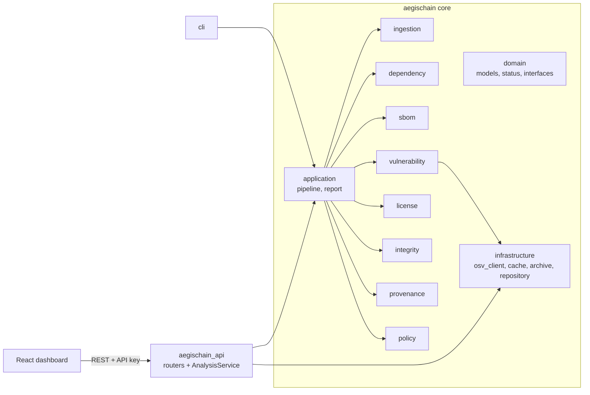

# Component Architecture

## Engine responsibilities

| Engine | Entry point | Input | Output |
|---|---|---|---|
| Ingestion | `engines/ingestion/scanner.py` | directory | `IngestionResult` (files, digests, warnings) |
| Dependency | `engines/dependency/service.py` | ingestion + files | `DependencyResult` (components, edges, findings) |
| SBOM | `engines/sbom/service.py` | components | CycloneDX, SPDX, validation reports |
| Vulnerability | `engines/vulnerability/provider.py` | components | `VulnerabilityReport` |
| License | `engines/license/evaluator.py` | declared licenses | `LicenseFinding[]` |
| Integrity | `engines/integrity/hasher.py` | file + reference digest | `IntegrityResult` |
| Provenance | `engines/provenance/verifiers/` | statement + bundle | `ProvenanceResult` (named checks) |
| Policy | `engines/policy/` | `SecurityEvidence` + `SecurityPolicy` | `PolicyEvaluation` |

## Extension points (Protocols in `domain/interfaces.py`)

* `ManifestParser` - add an ecosystem by implementing `parse(content, path)` and registering it in
  `engines/dependency/parsers/__init__.py`. Parsers receive **bytes**, never paths.
* `VulnerabilityProvider` - OSV, static fixtures and "skipped" providers exist; another source
  (e.g. an internal advisory feed) only needs `query(components)`.
* `SignatureVerifier` - the default delegates to the `sigstore` CLI; tests use a static double.
* `AnalysisRepository` - SQLite (stdlib) and SQLAlchemy/PostgreSQL implementations.
