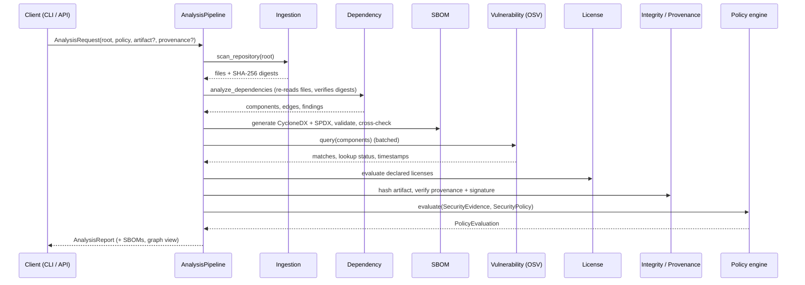

# Data Flow

## Step by step

1. **Ingestion** walks the tree without following links, skips credential-like files (names only are
   recorded), enforces limits, hashes each supported manifest/lockfile and derives a content-based
   `repository_id`.
2. **Dependency analysis** re-reads each file through `load_file`, which refuses to continue if the
   digest changed after ingestion. Parsers turn bytes into declared dependencies or resolved
   lockfile packages; the service merges them per directory/ecosystem into components and edges.
3. **SBOM generation** maps one internal model to CycloneDX 1.5 and SPDX 2.3, validates each
   structurally and cross-checks that both describe the same components and edges.
4. **Vulnerability lookup** sends one batch request per 1000 components, fetches full records for
   returned ids (cached by id + `modified`), normalises severity, and re-checks affected ranges
   locally.
5. **License evaluation** parses SPDX expressions and applies allow/deny patterns.
6. **Integrity and provenance** run only when an artifact/provenance is supplied.
7. **Policy evaluation** is a pure function of the evidence, the policy and an `as_of` date.
8. The **report** records an evidence digest so identical inputs are provably identical.

Any exception inside steps 2, 3 or 4 is converted into `INDETERMINATE` evidence plus an entry in
`report.errors`; the pipeline never returns without a decision.
