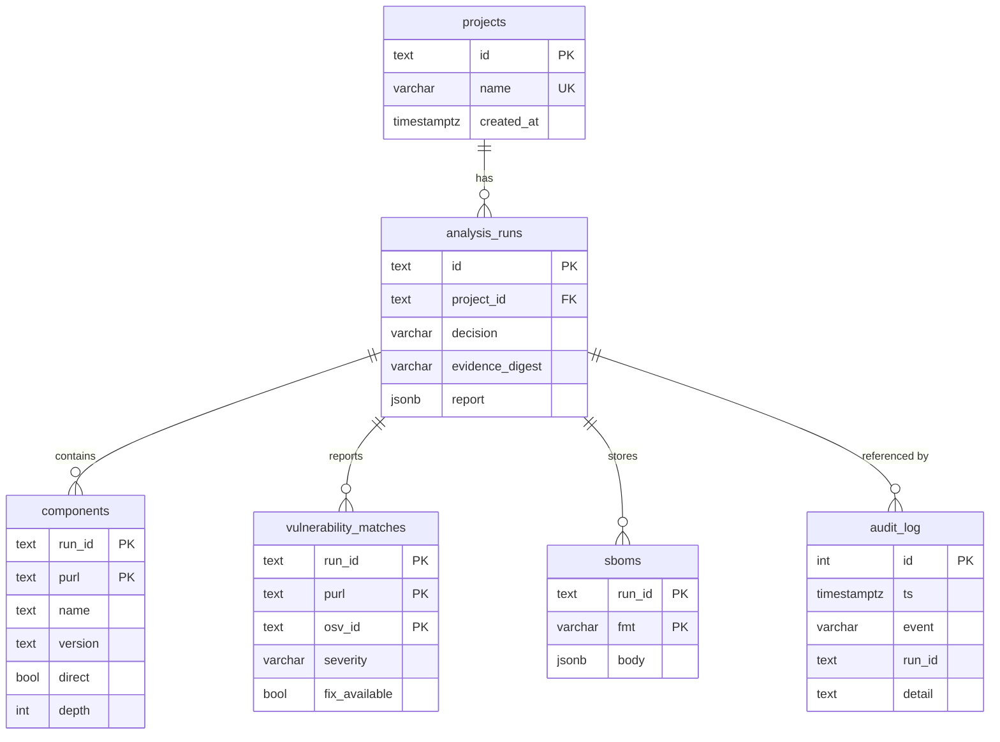

# Database Design

PostgreSQL is the production store (SQLAlchemy 2 Core + Alembic). A stdlib SQLite implementation of
the same `AnalysisRepository` protocol is used for development and tests.

## Principles

* UUID (v4, as text) identifiers; foreign keys everywhere; UTC `timestamptz`.
* The complete report is stored as `JSONB` (`analysis_runs.report`) so a run can be re-evaluated
  under another policy without re-collecting evidence; hot query fields (`components`,
  `vulnerability_matches`) are normalised and indexed.
* **Immutability.** `analysis_runs` rejects `UPDATE`; `audit_log` rejects `UPDATE` and `DELETE`
  (PostgreSQL triggers in migration `0001`, SQLite triggers in the stdlib implementation).
* A `CHECK` constraint limits `decision` to the four statuses.
* Schema changes go through Alembic only; the application never calls `create_all`.

## Mapping to the roadmap's table list

The roadmap listed 17 tables. `manifests`, `dependency_relationships`, `license_findings`,
`artifacts`, `artifact_digests`, `signatures`, `provenance_records`, `security_policies`,
`policy_evaluations` and `audit_reports` are **stored inside the run's JSONB report** rather than as
separate tables, because they are only ever read together with their run and are immutable. They can
be promoted to tables when a cross-run query needs them; that is an additive migration.
