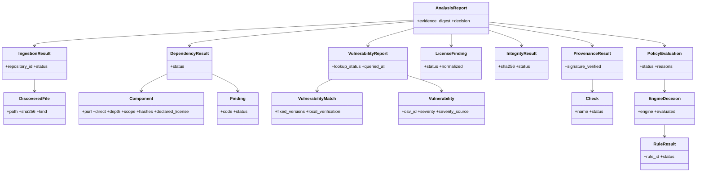

# Domain Model

All models are frozen dataclasses in `aegischain/domain/models.py`. They serialise through
`to_jsonable` and deserialise through `from_jsonable` (a round trip test proves equality).

## Notes

* **Component identity** is its Package URL (`pkg:pypi/requests@2.32.0`,
  `pkg:npm/%40babel/core@7.0.0`). Unpinned components have a purl without a version and
  `version = None`.
* `Component.direct` means *declared in a manifest or marked direct by the lockfile*. For a bare
  `requirements.txt` it only means "listed"; the file cannot distinguish transitive pins and the
  tool does not guess.
* `Component.depth` is the minimal distance from a direct dependency (direct == 1); `None` means
  unreachable from any direct dependency (reported as `UNREACHABLE`).
* `VulnerabilityMatch.local_verification` is `CONFIRMED`, `UNVERIFIED` or `CONTRADICTED`.
  Contradicted matches are still reported: the tool does not silently discard what OSV says.
* `Status.INDETERMINATE` is first-class. See the decision semantics in `system-architecture.md`.
