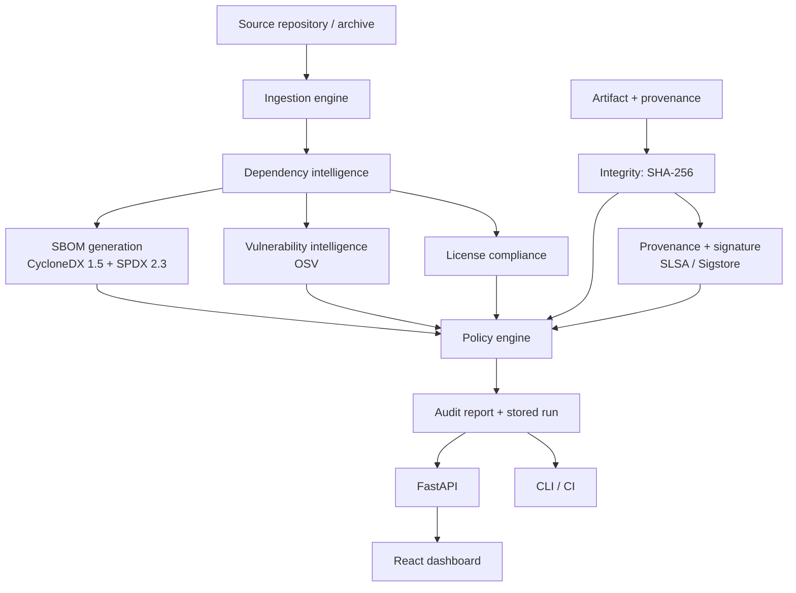

# System Architecture

## Overview

AegisChain takes a software repository (and optionally a build artifact with provenance evidence),
runs a fixed set of analysis engines, and produces a **deterministic security decision**:
`PASS`, `FAIL`, `WARN` or `INDETERMINATE`, together with SBOMs and an audit report.

The first version is a **modular monolith**. Engines are separate Python packages with explicit
interfaces, but they are deployed as one process. Microservices would add deployment and debugging
cost without a matching benefit at this scale (see ADR-0001).



## Layers

| Layer | Location | Responsibility |
|---|---|---|
| Domain | `aegischain/domain` | Immutable models, `Status`/`Severity`, engine interfaces (Protocols) |
| Engines | `aegischain/engines/*` | One responsibility each; no knowledge of HTTP or databases |
| Application | `aegischain/application` | `AnalysisPipeline` orchestration, report rendering/writing |
| Infrastructure | `aegischain/infrastructure` | OSV client, HTTP transport, cache, archives, repositories (SQLite, SQLAlchemy) |
| API | `apps/api` | FastAPI routers, schemas, authentication; framework-free `AnalysisService` |
| Presentation | `apps/web` | React + TypeScript dashboard; every number comes from the API |
| Delivery | `docker/`, `.github/` | Docker Compose, CI, security scans, release attestation |

The dependency rule points inward: engines never import from `application` or `apps`. The one
deliberate exception is the vulnerability provider, which uses the `infrastructure` OSV client and
cache (both injected, so tests substitute fakes). The core can be driven from the CLI, the REST API
or CI without modification.

## Cross-cutting design rules

1. **Fail-safe.** A failed or skipped check is `INDETERMINATE` (or `FAIL`), never `PASS`.
   `worst([])` is `INDETERMINATE`.
2. **No invented data.** Versions, licenses, hashes and suppliers are only recorded when a source
   states them. Unknown stays unknown.
3. **Traceability.** Components carry their source files; vulnerabilities carry severity source,
   query timestamp and local verification status; every report has an evidence digest.
4. **Reproducibility.** Clocks are injected, JSON output is canonical, identifiers (repository id,
   SBOM serial number, SPDX namespace) are content-derived.
5. **Untrusted input.** Repository content, archives, policies, provenance and API input are all
   validated; repository code is never executed.
6. **Observability.** JSON-lines structured logging and per-stage timing metrics in every report.

## Decision semantics

```
FAIL  >  INDETERMINATE  >  WARN  >  PASS
```

The final decision is the worst engine status. `INDETERMINATE` means *the evidence needed to decide
is missing or could not be verified*; it is distinct from `FAIL`, which means *evidence shows a
policy violation*. A pipeline exit code reflects this: 0 PASS/WARN, 1 FAIL, 2 INDETERMINATE.

## Deployment

`docker-compose.yml` runs PostgreSQL, a one-shot Alembic migration, the API (read-only root
filesystem, all capabilities dropped, non-root) and an nginx container serving the dashboard and
proxying `/api`. The dashboard never talks to the database.
