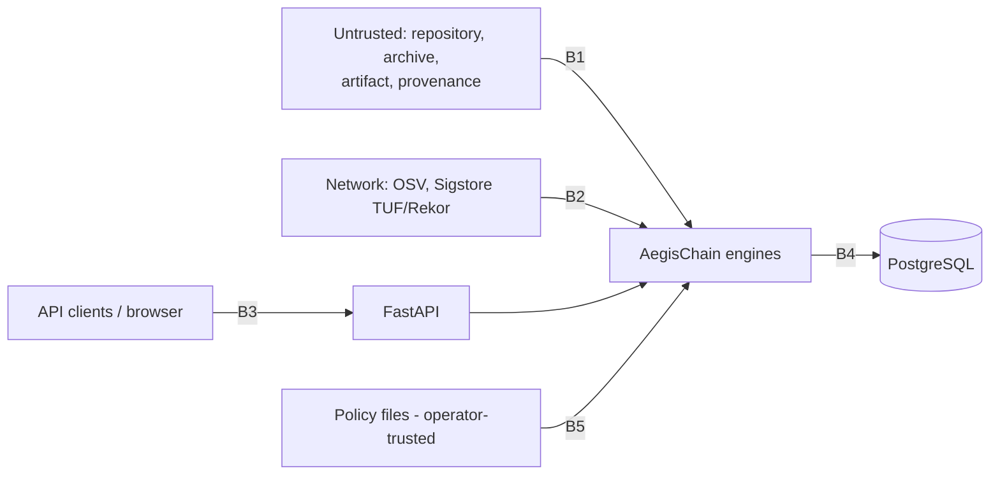

# Threat Model

Method: STRIDE over the trust boundaries below. "Residual risk" lists what remains after controls.

## Assets

| Asset | Why it matters |
|---|---|
| Integrity of the decision | A false PASS ships a vulnerable or tampered release |
| Analysis host (CLI runner / API server) | Must not be compromised by analysed content |
| API key, database contents, stored reports | Confidentiality of customers' dependency inventories |
| Policy files | Weakening a policy weakens every decision |
| Local OSV cache | Poisoning could hide vulnerabilities |

## Trust boundaries

## Threats and controls

| ID | STRIDE | Threat | Controls | Residual risk |
|---|---|---|---|---|
| T1 | Tampering/EoP | Repository contains symlinks to host files | Links never followed; real path re-checked under root; tests | None known |
| T2 | EoP | Zip-slip / tar traversal / link members in upload | Name validation, link/special-file rejection, extraction under resolved dest; tests | Race with other local processes writing to the temp dir (private `mkdtemp`) |
| T3 | DoS | Compression bomb, huge manifest, huge graph | Streaming size limits, member count, per-file limits, linear algorithms, SCC not path enumeration; tests with 2000-node cycle | CPU time is not capped per request; use container/CPU limits and a reverse-proxy timeout |
| T4 | Info disclosure | Credentials in repo end up in reports | Credential-like files never opened; only relative names recorded; test asserts secret text absent | A secret embedded in a *manifest* (e.g. URL with token in a dependency spec) would be parsed and could appear in findings |
| T5 | Spoofing | Forged provenance claims a trusted builder | Subject digest compared to the artifact; builder/source checked against policy; signature delegated to Sigstore; absence = INDETERMINATE | Depends on Sigstore client correctness and on the operator's trust policy |
| T6 | Tampering | Manifest altered between ingestion and parsing | SHA-256 recorded at ingestion and re-verified on every read | None for this path |
| T7 | Tampering | Artifact modified while hashed | fstat before/after + byte count; INDETERMINATE | Local attacker with write access can still swap before the first read |
| T8 | Tampering | OSV outage/MITM turned into "clean" | HTTPS only; failures -> FAILED/PARTIAL -> INDETERMINATE; malformed responses rejected; id echo checked | Compromised OSV or TLS root store |
| T9 | Tampering | Cache poisoning | Entries bound to id + `modified`; corrupt entries are misses | Local write access to cache dir; use a private, non-shared cache |
| T10 | Spoofing | Unauthenticated API use | Mandatory API key (>=16 chars), constant-time compare, refuse to start without it | Single shared key; no per-user identity or rate limiting (see limitations) |
| T11 | Tampering | Policy file executes code | `yaml.safe_load` only; strict schema; empty policy refused | Operator-trusted file; protect with repo review |
| T12 | Repudiation | Silent change of history | Runs immutable; audit log append-only (DB triggers); evidence digest | A DB superuser can disable triggers |
| T13 | DoS | Path/regex abuse in names | Names treated as data; policy names matched against `^[A-Za-z0-9._-]+$` and an allow-list | - |
| T14 | EoP | API reads arbitrary server files | Clients never supply paths; uploads spooled to private temp dirs; policies by name only | - |
| T15 | Info disclosure | Browser exposure of API key | Key kept in `sessionStorage` for the tab only; CSP and security headers; same-origin proxy | XSS in the dashboard would expose it; React escapes by default and no `dangerouslySetInnerHTML` is used |

## Assumptions

* The operator controls policies, the deployment and the OSV/Sigstore network paths.
* The analysis host is not shared with untrusted local users.
* Analysed repositories are untrusted; analysed *artifacts* may be hostile files (they are only
  hashed, never opened or executed).
